<p align="center">
  
</p>

<h1 align="center">Wireless HotSwap MX Ergo Split Corne Keyboard</h1>
<p align="center">Compacto, inalámbrico y pensado para aprovechar al máximo cada tecla</p>

## Hardware y firmware

- **Controladores:** nice!nano v2 (uno por mitad)
- **Pantallas:** nice!view
- **Firmware:** [ZMK](https://zmk.dev) v0.3, compilado con GitHub Actions
- **ZMK Studio:** habilitado en la mitad izquierda (por USB)
- **Keymap:** importado de un layout de VIA (`crkbd.layout.json`) y convertido a ZMK

## Capas

| # | Capa | Cómo se activa | Contenido |
|---|------|----------------|-----------|
| 0 | Base | — | QWERTY |
| 1 | Num | Mantener el pulgar izquierdo interno (`Num`) | Números, flechas y símbolos con Shift |
| 2 | Numpad | Sin acceso desde la capa Base (ver nota) | Teclado numérico y multimedia |
| 3 | Sym | Mantener `Num` y después el pulgar derecho del medio (`Sym`) | Símbolos, Bluetooth, Studio y bootloader |

Las teclas resaltadas en las imágenes son las que hay que mantener apretadas para estar en esa capa. `▽` significa que la tecla hereda lo que tenga la capa de abajo.

#### Base (capa 0)


#### Num (capa 1): números, flechas y símbolos


#### Numpad (capa 2): teclado numérico y multimedia


#### Sym (capa 3): símbolos, Bluetooth y mantenimiento


> **Nota:** la capa Numpad venía así del layout de VIA original: ninguna tecla de la capa Base lleva a ella. Para usarla hay que asignar `&mo 2` a alguna tecla en `config/corne.keymap`.

## Bluetooth y mantenimiento

Todo se hace desde la capa **Sym**: mantené `Num` (pulgar izquierdo interno), después `Sym` (pulgar derecho del medio) y tocá la tecla con la mano izquierda. El orden importa: si apretás primero el pulgar derecho, sale `AltGr`.

| Tecla en Sym | Tecla en Base | Qué hace |
|--------------|---------------|----------|
| BT Clear | Tab | Borra el emparejamiento del perfil activo |
| BT 0–4 | Q, W, E, R, T | Cambia al perfil Bluetooth 0 a 4 (un dispositivo por perfil) |
| Studio | Shift izq. | Desbloquea [ZMK Studio](https://zmk.studio) |
| Boot | Ctrl izq. | Pone la mitad izquierda en modo de flasheo |

- **Emparejar un dispositivo nuevo:** elegí un perfil libre y buscá `Corne` en el Bluetooth del dispositivo.
- **Si un emparejamiento falla:** elegí el perfil, tocá BT Clear, olvidá `Corne` en el dispositivo y emparejá de nuevo.

## Compilar y flashear

1. Cada push a `config/` dispara el workflow **Build ZMK firmware** (pestaña **Actions**).
2. Al terminar, descargá el zip desde **Artifacts** en la ejecución correspondiente.
3. Conectá una mitad por USB y ponela en modo de flasheo: doble toque al botón de reset, o la tecla `Boot` (solo la mitad izquierda).
4. Aparece una unidad `NICENANO`: arrastrá el `.uf2` que corresponde a esa mitad (`corne_left…` o `corne_right…`).
5. Repetí con la otra mitad.

Si las mitades no se conectan entre sí, flasheá `settings_reset` en las dos, y después de nuevo el firmware normal de cada una.

## Estructura del repo

```
config/
  corne.keymap          Keymap (capas y teclas)
  corne.conf            Opciones de ZMK (suspensión, nombre del teclado)
  west.yml              Versión de ZMK
build.yaml              Qué firmwares compila GitHub Actions
docs/
  layers/*.svg          Imágenes de las capas
  keymap.yaml           Keymap en formato keymap-drawer
  draw_layers.sh        Regenera las imágenes
  index.html            Todas las capas en una página
```

### Regenerar las imágenes

Las imágenes se generan con [keymap-drawer](https://github.com/caksoylar/keymap-drawer) a partir de `config/corne.keymap`. Después de cambiar el keymap:

```bash
pip install keymap-drawer
./docs/draw_layers.sh
```
