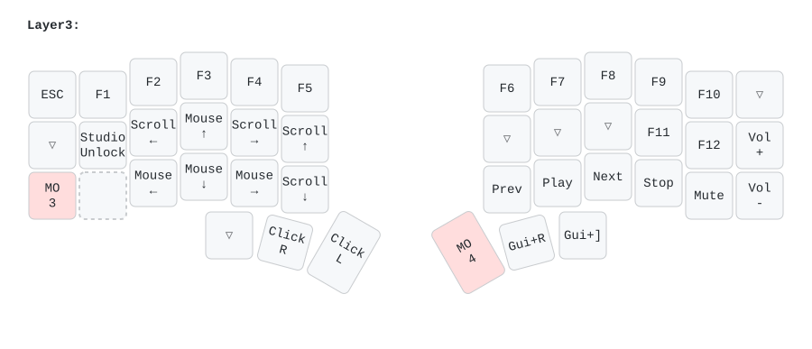

  

<h1 align="center">Wireless HotSwap MX Ergo Split Corne Keyboard</h1>

Compacto, inalámbrico y pensado para aprovechar al máximo cada tecla

### Layer previews

Generadas automáticamente desde [`config/corne.keymap`](config/corne.keymap) con [keymap-drawer](https://github.com/caksoylar/keymap-drawer). Para verlas todas juntas en local abrí [`docs/index.html`](docs/index.html).

#### Base (capa 0)

#### Lower (capa 1) — números y símbolos

#### Raise (capa 2) — navegación y macros

#### Capa 3 — F-keys, mouse y Studio unlock (mantener `MO 3`)

#### Capa 4 — Bluetooth (mantener `MO 3` + pulgar derecho interno)

